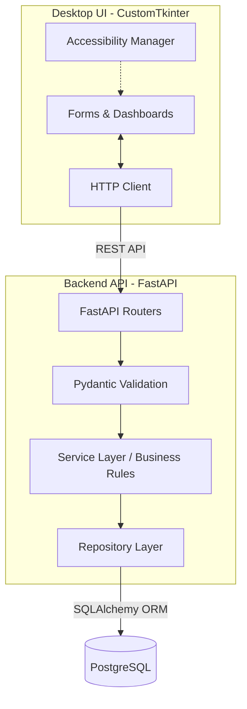

# Pharmacy Management System: Software Requirements Specification (SRS) & System Architecture

## A. Project Definition

**Problem Statement:** Pharmacies often struggle with manual inventory tracking, selling expired medicines, stockouts, and disjointed billing processes. Additionally, standard pharmacy software frequently lacks accessibility features, making it difficult for visually impaired or motor-impaired staff to operate effectively.

**Project Vision:** To deliver a commercial-grade, highly accessible Pharmacy Management System that prevents operational errors (like dispensing expired medicines) and strictly adheres to Total Quality Management (TQM) principles.

**Project Mission:** To build a layered, reliable desktop application using Python (CustomTkinter, FastAPI, SQLAlchemy, PostgreSQL) that enforces business rules at the backend, ensures data integrity, and prioritizes a Q12 Accessibility standard.

**Project Objectives:**

1. Develop a fully functional, 3-tier desktop application for pharmacy management.
2. Implement TQM cycles: Error Prevention → Process Control → Monitoring → Continuous Improvement.
3. Achieve high accessibility via Q12 standards (high contrast, keyboard navigation, font resizing).
4. Fulfill the academic requirements of the BBAT104 Fundamentals of TQM course.

**Project Scope:**

* **In-Scope:** Role-based access control (Admin, Pharmacist, Cashier), medicine inventory tracking, batch/expiry management, sales and billing, purchase management, supplier and customer tracking, accessibility settings, and audit logs.
* **Out-of-Scope:** Integration with external payment gateways, online e-commerce storefronts, and automated hardware dispensing machines.

**Intended Users & Stakeholders:**

1. **Admin:** System owners/managers.
2. **Pharmacist:** Inventory and clinical stock managers.
3. **Cashier/Pharmacy Staff:** Front-desk billing staff.

**Assumptions and Constraints:**

* Target environment is a Windows Desktop.
* A local or network-hosted PostgreSQL database is available.
* The system is deployed via an Inno Setup installer.

---

## B. Functional Requirements

### Authentication and Authorization

* **FR-AUTH-01:** The system shall authenticate users via username and password, checking credentials against hashed values in the database.
* **FR-AUTH-02:** The system shall authorize users into three distinct roles: Admin, Pharmacist, and Cashier, hiding unauthorized modules from the UI.

### Admin Dashboard & User Management

* **FR-ADM-01:** The Admin shall be able to create, update, and deactivate user accounts.
* **FR-ADM-02:** The Admin dashboard shall display summary metrics (e.g., total sales, alerts, active users).

### Medicine & Inventory Management

* **FR-MED-01:** Pharmacists and Admins shall be able to add, update, and categorize medicines.
* **FR-INV-01:** The system shall track inventory using batch numbers and expiry dates.
* **FR-INV-02:** The system shall automatically reduce available stock upon a completed sale.

### Batch and Expiry Management

* **FR-EXP-01:** The system shall block the addition of any medicine batch that is already expired.
* **FR-EXP-02:** The system shall visually flag medicines expiring within 30 days.
* **FR-EXP-03:** The system shall strictly prevent the sale of expired medicines at the backend level.

### Sales and Billing

* **FR-SAL-01:** Cashiers shall be able to search for medicines, add them to a cart, and generate a bill.
* **FR-SAL-02:** The system shall prevent a sale if the requested quantity exceeds available stock.

### Purchases & Suppliers

* **FR-PUR-01:** Pharmacists shall be able to record incoming purchases and assign them to specific suppliers.
* **FR-SUP-01:** The system shall maintain a directory of suppliers and their contact details.

### Customers

* **FR-CUS-01:** Cashiers shall be able to optionally save customer details (name, phone) during a sale.

### Accessibility Settings

* **FR-ACC-01:** All users shall be able to toggle high-contrast mode, dark mode, and adjust font sizes. Settings must persist across sessions.

### Audit Logs & Monitoring

* **FR-AUD-01:** The system shall log all critical events (logins, sales, stock adjustments, failed transactions) with user ID and timestamp.
* **FR-MON-01:** The system shall provide error and quality monitoring reports (e.g., frequency of blocked expired-sales).

---

## C. Non-Functional Requirements

* **Accessibility (NFR-ACC):** All interactive UI elements must be navigable via the `Tab` key. Font sizes must scale between 100% and 200% without breaking the UI.
* **Security (NFR-SEC):** Passwords must be hashed using bcrypt. Database credentials must be managed via `.env` files and not hardcoded into the client UI.
* **Performance (NFR-PER):** API responses for medicine lookup must complete in under 300ms on a local network.
* **Reliability (NFR-REL):** Database transactions must follow ACID properties. A failed sale step (e.g., inventory update fails) must rollback the entire transaction.
* **Data Integrity (NFR-DAT):** Foreign key constraints must be strictly enforced (e.g., a sale cannot reference a non-existent medicine).
* **Maintainability (NFR-MNT):** Code must be strictly decoupled: UI -> API -> Service -> Repository.

---

## D. UI and Navigation

**1. Login Screen:**

* Minimalist design with fields for Username, Password, and a "Login" button.
* Accessibility controls (font size, contrast toggle) visible in the corner before login.

**2. Role-Specific Navigation:**

* **Admin:** Users, Medicines, Inventory, Purchases, Sales, Reports, Audit Logs, Settings.
* **Pharmacist:** Medicines, Inventory, Purchases, Sales, Reports, Settings.
* **Cashier:** Point of Sale (POS), Customers, Settings.

**3. Screens:**

* **POS Screen:** Search bar, Cart table, Customer details form, Total/Checkout buttons.
* **Inventory Screen:** Data table with color-coded expiry dates (Red = Expired, Yellow = Near Expiry).
* **Settings:** Toggles for Dark Mode, High Contrast, Font Size sliders.

---

## E. Click-by-Click Workflows

### Workflow 1: Process a Sale (Cashier)

1. **UI Action:** Cashier searches for a medicine and clicks "Add to Cart", then clicks "Checkout".
2. **API Endpoint:** UI sends a `POST /sales` request with cart payload.
3. **Service Layer:** `SaleService.create_sale()` validates quantities and checks expiry dates.
4. **Validation:** Checks if any item is expired or exceeds stock.
5. **Repository Layer:** `SaleRepository` creates the sale record. `InventoryRepository` deducts stock.
6. **Database Transaction:** Both operations are wrapped in a single SQL transaction.
7. **Response:** Returns `201 Created` with a receipt ID.
8. **Error Handling:** If stock is insufficient, triggers a rollback and returns `400 Bad Request`.

### Workflow 2: Block an Expired-Medicine Sale

1. **UI Action:** Cashier attempts to add an expired batch to the cart.
2. **API Endpoint:** UI sends `POST /sales`.
3. **Service Layer:** `SaleService` detects the expiry date is `< CURRENT_DATE`.
4. **Validation:** `BusinessRuleError("Cannot sell expired medicine.")` is raised.
5. **Database Transaction:** Process is aborted before any DB inserts.
6. **Response:** `422 Unprocessable Entity`.
7. **Error Handling:** UI displays a clear, highly visible error dialog: "Error: Batch X is expired."

---

## F. System Architecture

**Architecture Style:** 3-Tier Layered Architecture (Client-Server over localhost/LAN).

* **CustomTkinter UI:** Purely presentational. Handles rendering, accessibility settings, and capturing input. Communicates *only* with the FastAPI backend via HTTP requests.
* **FastAPI Routes/Controllers:** Receives HTTP requests, validates payload syntax using Pydantic, routes to the appropriate Service.
* **Service Layer:** Contains core business logic (e.g., TQM rules, expiry checks, calculating totals).
* **Repository Layer:** Abstracts database queries. Contains SQLAlchemy session logic.
* **SQLAlchemy ORM:** Maps Python objects to PostgreSQL tables.
* **PostgreSQL:** Relational database storing all persisted data.



---

## G. Data Requirements (Core Entities)

1. **User:** `id` (PK), `username`, `password_hash`, `role` (Admin/Pharmacist/Cashier), `is_active`.
2. **Medicine:** `id` (PK), `name`, `generic_name`, `category_id` (FK), `reorder_level`.
3. **Batch:** `id` (PK), `medicine_id` (FK), `batch_number`, `expiry_date`, `quantity`, `unit_price`.
4. **Sale:** `id` (PK), `user_id` (FK), `customer_name`, `total_amount`, `timestamp`.
5. **SaleItem:** `id` (PK), `sale_id` (FK), `batch_id` (FK), `quantity`, `price_at_sale`.
6. **AuditLog:** `id` (PK), `user_id` (FK), `action`, `entity`, `details`, `timestamp`.

---

## H. Folder Structure

```text
PHARMacy-management-system/
│
├── app/
│   ├── ui/                    # CustomTkinter UI Client
│   │   ├── views/             # Screens (login, pos, inventory)
│   │   ├── components/        # Reusable UI widgets
│   │   ├── accessibility.py   # Theme, contrast, font managers
│   │   └── client.py          # HTTP requests wrapper
│   │
│   ├── api/                   # FastAPI Backend
│   │   ├── routes/            # API Endpoints
│   │   ├── services/          # Business logic & TQM rules
│   │   ├── repositories/      # SQLAlchemy data access
│   │   ├── models/            # SQLAlchemy DB models
│   │   └── schemas/           # Pydantic validation schemas
│   │
│   ├── core/                  # Configurations, Security, Logging
│   └── database.py            # DB connection setup
│
├── tests/                     # pytest suite
├── docs/                      # SRS, Architecture diagrams, TQM docs
├── scripts/                   # DB migrations, seed data
├── .env                       # Environment variables
├── main.py                    # Entry point (Launches API and UI)
└── requirements.txt           # Python dependencies
```

---

## I. TQM Mapping

| Pharmacy Risk | Failure Mode | Prevention Mechanism | Process Control | Monitoring Metric | Relevant TQM Tool |
| :--- | :--- | :--- | :--- | :--- | :--- |
| Dispensing Expired Meds | Cashier sells an expired batch | Backend blocks sale of batches where expiry < today | UI highlights near-expiry items in red | # of attempted expired sales blocked | FMEA, Poka-Yoke |
| Stockouts | Insufficient meds to meet patient needs | System alerts when stock < reorder_level | Pharmacist reviews low-stock dashboard | Frequency of stockouts per month | Pareto Analysis |
| Data Corruption | App crashes during a sale | Use SQL Transactions (ACID properties) | DB Rollbacks on error | DB transaction failure rate | SIPOC |
| Unauthorized Access | Cashier deletes inventory | Role-based UI hiding + API endpoint role verification | Audit logs track all data mutations | # of unauthorized API access attempts | Control Charts |

---

## J. Acceptance and Testing Plan

1. **Unit Testing (pytest):** Test all Service layer business rules (e.g., `test_sale_prevented_if_expired`).
2. **Integration Testing:** Test Repository layer against a local test PostgreSQL database.
3. **Accessibility Testing:** Manual testing via keyboard-only navigation. Verify color contrast ratios using standard tools. Verify font scaling via UI toggles.
4. **Security Testing:** Attempt to bypass API routes using a Cashier token on Admin routes. Ensure DB credentials are not accessible from the UI source files.
5. **UAT (User Acceptance Testing):** Conduct a simulated shift (logging in, processing a sale, checking inventory, viewing reports).

---

## Summary of Architectural Decisions

1. **Decoupled Architecture:** Using a desktop client communicating over HTTP to a FastAPI backend running locally. This allows for a future transition where the backend is hosted in the cloud, serving multiple pharmacy branches, without rewriting the core logic.
2. **Backend Authority:** The CustomTkinter UI is "dumb". It assumes the user is hostile. All business rules (expiry, stock, roles) are enforced strictly on the API/Service layer.

## Unresolved Questions & Assumptions

* **Assumption:** The application will run the FastAPI server and the UI on the same machine for the initial release (localhost).
* **Question:** Do you have the `BBAT104` rubric/guidelines file? If so, please provide it so I can ensure 100% compliance with specific academic grading criteria.

## Prioritized Implementation Roadmap

1. **Phase 1:** Setup PostgreSQL, SQLAlchemy models, and basic FastAPI CRUD for Users and Medicines.
2. **Phase 2:** Implement Service layer logic (Inventory constraints, Expiry checks) and Pytest suite.
3. **Phase 3:** Develop CustomTkinter UI framework with the Accessibility Manager (Q12 goal).
4. **Phase 4:** Build the UI screens (Login, POS, Inventory) and connect to API.
5. **Phase 5:** Implement Reporting, Audit Logs, and final TQM dashboard features.
6. **Phase 6:** Packaging (PyInstaller) and Installation (Inno Setup).
