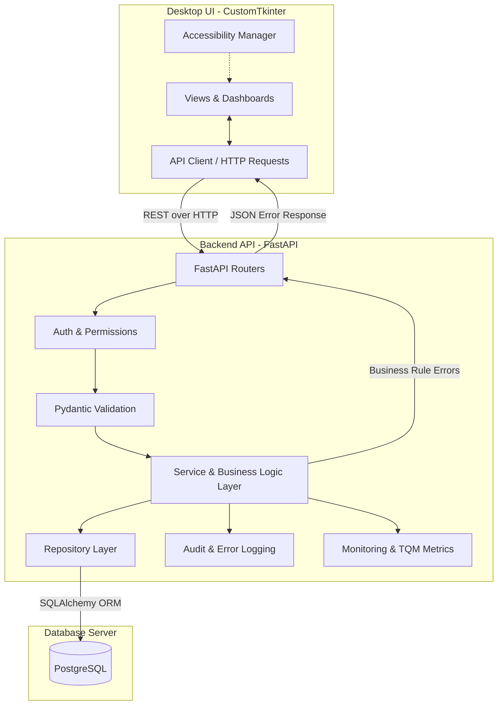
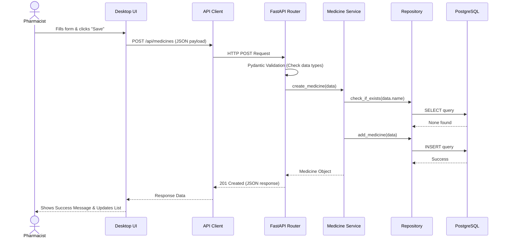
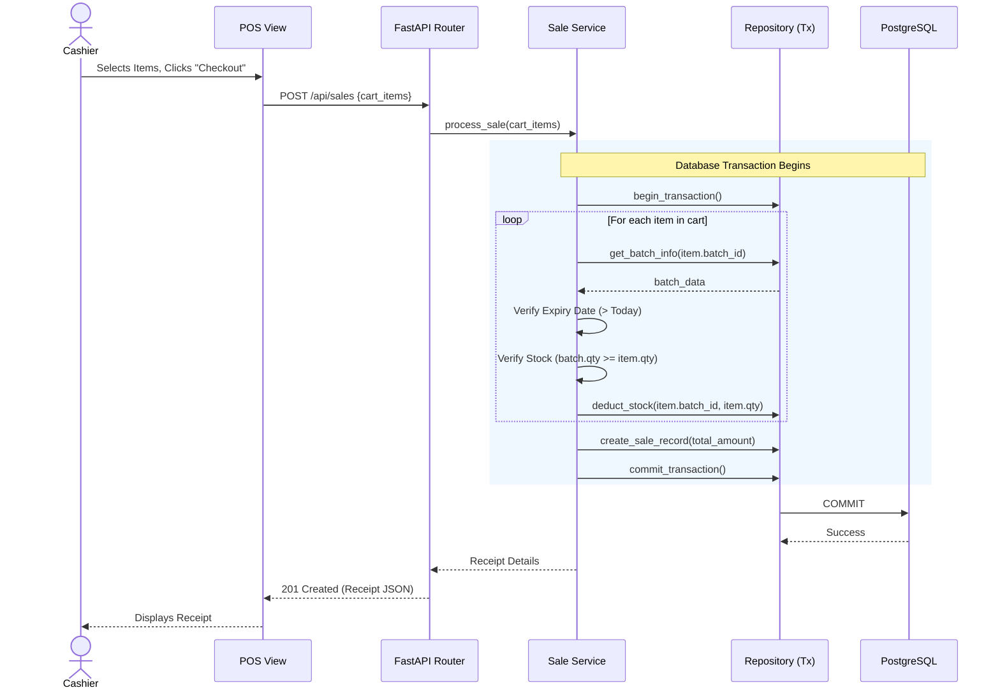
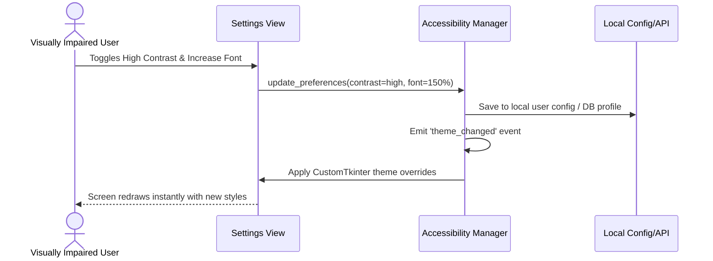

# Pharmacy Management System: System Architecture

## A. Architecture Overview

**Purpose of the Architecture:**
This architecture serves as the blueprint for developing the Pharmacy Management System. It ensures that the application is secure, maintainable, accessible (meeting the Q12 quality goal), and aligned with Total Quality Management (TQM) principles to prevent errors.

**Architecture Style and Justification:**
The system employs a **3-Tier Layered Architecture** using a local Client-Server model. The CustomTkinter desktop application acts as the presentation tier, making HTTP REST API calls to a locally-hosted FastAPI server, which in turn interacts with a PostgreSQL database. 
* **Justification:** Decoupling the UI from the database prevents unauthorized direct data manipulation, ensures business rules (like expiry checks) are enforced universally, and provides a clear migration path to a cloud-hosted commercial product serving multiple terminals.

**High-Level System Components:**
1. **Desktop Client:** CustomTkinter UI for user interaction and accessibility settings.
2. **Backend API:** FastAPI server handling requests, routing, and schema validation.
3. **Business/Service Layer:** Core logic, TQM rules, and role authorization.
4. **Data Access/Repository Layer:** SQLAlchemy database operations.
5. **Database:** PostgreSQL for persistent data storage.

**Desktop Deployment Model:**
Initially, both the UI client and the FastAPI server will run on the same Windows desktop machine. They will be packaged together using PyInstaller and distributed via an Inno Setup installer. The server will bind to `localhost`.

**Evolution to a Commercial Product:**
By separating the UI and API, the system can easily evolve. A pharmacy can install the API and database on a back-office server, and multiple cashier terminals can run the desktop client pointing to the server's IP address on the local network.

---

## B. System Architecture Diagram



---

## C. Layer Responsibilities

### 1. Desktop UI Layer (CustomTkinter)
* **Does:** Renders screens, captures user input, displays data and errors, manages local accessibility preferences (font size, contrast).
* **Must Not Do:** Directly connect to the database, perform complex business logic, or trust user input without backend validation.
* **Communicates with:** API Client Layer.
* **Example:** The POS screen captures the medicine search term and quantity.

### 2. API Client Layer
* **Does:** Packages UI data into HTTP requests (GET, POST, PUT, DELETE), attaches authentication tokens, handles network timeouts.
* **Must Not Do:** Perform business logic or store permanent state.
* **Communicates with:** Desktop UI, FastAPI routes.
* **Example:** Sends `POST /api/v1/sales` with the cart payload.

### 3. FastAPI Route/Controller Layer
* **Does:** Defines API endpoints, receives requests, triggers dependency injection (auth tokens, DB sessions), returns JSON responses or standard HTTP error codes.
* **Must Not Do:** Contain complex business logic or raw SQL queries.
* **Communicates with:** API Client, Pydantic Schema, Authentication Layer, Service Layer.
* **Example:** `def create_sale_endpoint(sale_data: SaleCreate, service: SaleService = Depends(...)):`

### 4. Pydantic Schema Layer
* **Does:** Validates incoming request payloads for correct data types and required fields, serializes outgoing data.
* **Must Not Do:** Check database state (e.g., verifying if an ID exists).
* **Communicates with:** FastAPI Routes, Service Layer.
* **Example:** Validates that `quantity` in a sale request is an integer > 0.

### 5. Authentication and Authorization Layer
* **Does:** Verifies JWT tokens or session hashes, extracts user roles, blocks unauthorized endpoints.
* **Must Not Do:** Handle general business logic.
* **Communicates with:** FastAPI Routes, Service Layer.
* **Example:** Rejects a Pharmacist trying to access `DELETE /api/v1/users`.

### 6. Service/Business Logic Layer
* **Does:** Orchestrates business rules, TQM constraints, calculates totals, triggers repository operations.
* **Must Not Do:** Parse HTTP requests or write raw SQL.
* **Communicates with:** Route Layer, Repository Layer.
* **Example:** `SaleService` checks if a medicine batch is expired before allowing the transaction.

### 7. Repository/Data-Access Layer
* **Does:** Abstract database queries, manages SQLAlchemy sessions.
* **Must Not Do:** Implement business rules (like checking expiry dates before returning data, unless filtering).
* **Communicates with:** Service Layer, SQLAlchemy ORM.
* **Example:** `InventoryRepository.deduct_stock(batch_id, quantity)`.

### 8. SQLAlchemy ORM Layer
* **Does:** Maps Python classes to PostgreSQL tables, handles query generation and dialect specifics.
* **Must Not Do:** Define business-specific application flow.
* **Communicates with:** Repository Layer, PostgreSQL.

### 9. PostgreSQL Database Layer
* **Does:** Persists data safely, enforces ACID transactions, primary/foreign keys, and database constraints.
* **Must Not Do:** Be accessible directly from the CustomTkinter UI.
* **Communicates with:** SQLAlchemy ORM.

### 10. Logging, Monitoring, and Reporting Components
* **Does:** Records audit trails of user actions, tracks failed operations (e.g., blocked expired sales), feeds data to TQM analysis tools (Pandas/Matplotlib).
* **Must Not Do:** Slow down critical operations (should run asynchronously or in fast batches).
* **Communicates with:** Service Layer, Database.
* **Example:** Logs when a Cashier attempts to sell more stock than is available.

---

## D. Module Architecture

* **Authentication and Users:** Manages user CRUD, secure login (bcrypt), role assignment.
* **Dashboard:** Aggregates metrics (daily sales, low stock alerts, near expiry alerts). Calculations are done by the API, UI just renders.
* **Medicine Management:** CRUD for drug catalog (names, categories, generic names, reorder levels).
* **Batch and Expiry Management:** Tracks specific shipments, quantities, cost price, and exact expiry dates.
* **Inventory Management:** Tracks current stock levels. Relies on TQM rules to prevent negative stock.
* **Sales and Billing:** Handles the POS cart, applies business rules (stock, expiry), generates receipts, and atomically deducts inventory.
* **Purchase Management:** Logs incoming stock from suppliers, updating inventory levels securely.
* **Supplier Management:** Directory of vendors for reordering.
* **Customer Management:** Tracks buyer details for recurring prescriptions or return tracing.
* **Reports:** Utilizes Pandas to aggregate data for sales trends, expiry wastage, and audit logs.
* **Accessibility Settings:** A local module in the UI handling UI scaling, colors, and keyboard mapping.
* **Audit Logs:** System-wide tracking of CRUD operations and critical errors.
* **Error and Quality Monitoring:** Tracks frequency of system blocks (prevented errors) for TQM analysis.
* **Backup and Recovery:** Scripts to dump and restore the PostgreSQL database safely.

---

## E. Three User Roles

| Module / Action | Admin | Pharmacist | Staff/Cashier |
| :--- | :--- | :--- | :--- |
| **Login & Auth** | Yes | Yes | Yes |
| **Manage Users** | Yes | No | No |
| **Manage Medicines**| Yes | Yes | Read-Only |
| **Manage Batches** | Yes | Yes | Read-Only |
| **Process Sales** | Yes | Yes | Yes |
| **Record Purchases**| Yes | Yes | No |
| **View Audit Logs** | Yes | No | No |
| **System Settings** | Yes | No | No |
| **Accessibility** | Yes | Yes | Yes |

**Backend Enforcement:**
UI components will be hidden based on the user's role token. Crucially, the FastAPI backend will enforce authorization using dependency injection (e.g., `Depends(verify_admin_role)`). A Cashier attempting to POST to a Pharmacist endpoint using a tool like Postman will receive a `403 Forbidden` response.

---

## F. Click-by-Click Sequence Diagrams

### Workflow 1: Add Medicine


### Workflow 2: Process a Sale (Atomic Transaction)

*Note on Concurrency:* If two cashiers sell the last unit simultaneously, PostgreSQL row-level locks (e.g., `SELECT ... FOR UPDATE`) during the transaction will ensure one succeeds and the other fails cleanly with an "Insufficient Stock" error.

### Workflow 3: Accessibility Settings


---

## G. Error Prevention, Process Control and Monitoring

1. **Error Prevention (Poka-Yoke):**
   * UI prevents typing letters into quantity fields (Input Validation).
   * Pydantic rejects negative prices.
   * System prevents adding a batch with an expiry date in the past.
2. **Process Control:**
   * Backend explicitly checks `batch.expiry_date` during the sale transaction. If expired, raises a `BusinessRuleError` and blocks the sale.
   * Atomic transactions ensure a system crash during checkout won't deduct inventory without saving the sale record.
3. **Monitoring:**
   * Audit logs record every blocked sale attempt (e.g., "Cashier attempted to sell Expired Batch B12").
   * Dashboard alerts pharmacists to stock items falling below the `reorder_level`.
4. **Continuous Improvement (TQM):**
   * Generated Pandas/Matplotlib charts show Pareto Analysis of "Reasons for Blocked Sales". If expired medicines are frequently brought to the counter, management knows the physical shelf-checking process (SIPOC) needs improvement.

---

## H. Accessibility Architecture — Q12

The UI will rely on a centralized `AccessibilityManager` singleton.
* **High Contrast & Dark Mode:** Uses CustomTkinter's built-in appearance modes and custom `.json` theme files designed for WCAG AAA contrast ratios.
* **Font Resizing:** All font sizes will be defined as variables bound to a global scale factor. Changing the scale updates all active widgets.
* **Keyboard Navigation:** Every actionable widget will explicitly configure `.focus_set()` sequences. `Tab` and `Shift+Tab` will traverse logically. Enter/Space will trigger buttons.
* **Minimalist Layout:** Whitespace, clear grouping, and avoidance of clutter.
* **Error Messages:** Will not rely solely on color (e.g., not just a red border). They will include clear text and icons (e.g., ⚠️ "Quantity exceeds stock").

---

## I. Security and Reliability

* **Password Hashing:** Implemented using `passlib` with `bcrypt`.
* **API Authentication:** Stateless JSON Web Tokens (JWT) passed in the `Authorization` header.
* **Secret Management:** Database URIs and JWT secret keys stored in a `.env` file, loaded via `pydantic-settings`.
* **Database Credentials:** Reside strictly on the server side (FastAPI). The UI client binary never contains DB passwords.
* **Audit Logging:** Implemented as a middleware or service hook that asynchronously writes CRUD events to the `audit_logs` table.
* **Backup:** Dedicated scripts calling `pg_dump` will run on a cron schedule or via Admin UI trigger.

---

## J. Recommended Folder Structure

```text
PHARMacy-management-system/
│
├── app/
│   ├── ui/                    # Desktop Client Layer
│   │   ├── views/             # CustomTkinter frames (dashboard, pos, etc.)
│   │   ├── components/        # Reusable accessible widgets
│   │   ├── core/              # HTTP client, auth state, AccessibilityManager
│   │   └── main_window.py     # Root UI window assembly
│   │
│   ├── api/                   # Backend Server Layer
│   │   ├── routes/            # FastAPI endpoints (e.g., sales.py, users.py)
│   │   ├── schemas/           # Pydantic models for validation
│   │   ├── services/          # Business logic and TQM rules
│   │   ├── repositories/      # SQLAlchemy data access classes
│   │   ├── models/            # SQLAlchemy database entity models
│   │   └── dependencies.py    # Auth and DB session providers
│   │
│   ├── core/                  # Shared configurations and constants
│   └── config.py              # Environment variable loading
│
├── tests/                     # Automated test suite (pytest)
│   ├── test_ui/               # Mocked UI tests
│   ├── test_api/              # Endpoint integration tests
│   └── test_services/         # Business logic unit tests
│
├── scripts/                   # DB migrations, seeding, backup scripts
├── docs/                      # Architecture, SRS, User Manuals
├── assets/                    # Icons, theme files, logos
├── .env                       # Environment configuration (ignored in git)
├── main.py                    # Application Entry Point
└── requirements.txt           # Dependency management
```

---

## K. Architecture Decision Records (ADRs)

1. **Why a desktop UI?** The project requirements stipulate a desktop application using CustomTkinter. Pharmacies often prefer offline-capable or dedicated terminal software over web browsers for speed and hardware integration (scanners/printers).
2. **Why is FastAPI separate?** Decoupling prevents the client binary from holding DB credentials, centralizes business rules, prevents tampering, and allows future multi-terminal networking.
3. **Why PostgreSQL?** It is highly robust, ACID-compliant, supports complex joins for reporting, and handles concurrent transactions (crucial for sales/inventory) better than SQLite.
4. **Why separate Service and Repository layers?** Repositories should only know about database syntax (SQLAlchemy). Services should only know about pharmacy rules (TQM, expiry). This makes testing business logic much easier without needing a real database.

---

## L. Testing Strategy

* **Service Logic:** Tested using `pytest` with mocked repositories to ensure TQM rules (e.g., expiry prevention) work instantly and reliably.
* **API Endpoints:** Tested using `TestClient` from FastAPI to verify route validation, Pydantic schemas, and HTTP status codes.
* **Repository Operations:** Tested against an isolated test database (or SQLite in-memory, though Postgres test DB is preferred to match production) to verify queries and transactions.
* **Role Permissions:** Endpoints tested with tokens generated for different roles to ensure 403 Forbidden is raised correctly.
* **Accessibility Features:** Primarily tested manually for keyboard flow and contrast, and automatically via UI unit tests checking if font-scaling updates widget properties.
* **End-to-End:** Simulate complete workflows (login -> add item -> sell item) programmatically.
