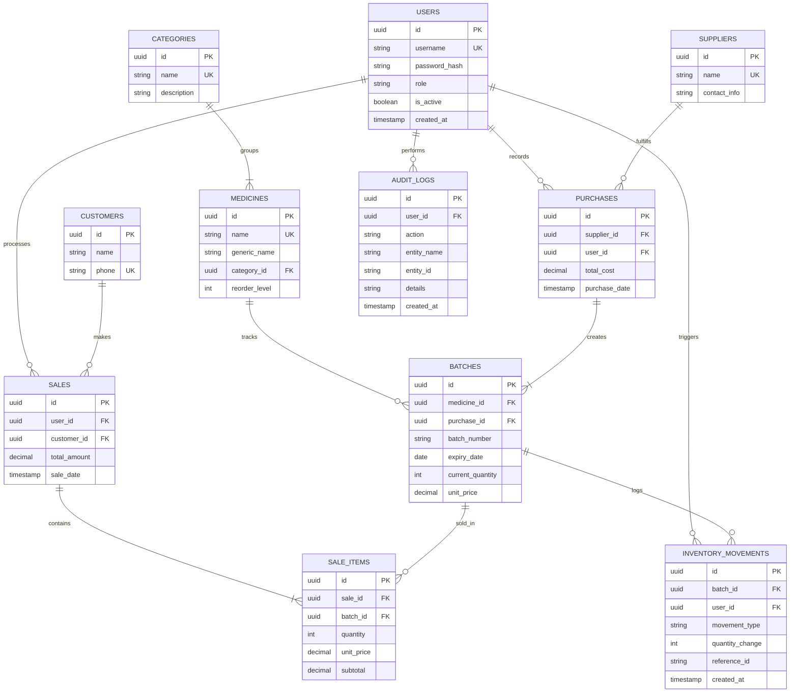

# Pharmacy Management System: Database Design

## 1. Database Architecture

**Stack Components:**
* **PostgreSQL:** Relational database chosen for its robustness, strict data integrity constraints, and MVCC (Multi-Version Concurrency Control) to handle concurrent sales effectively.
* **SQLAlchemy ORM:** Used to define schema as Python classes, allowing the Repository layer to interact with the database using object-oriented paradigms.
* **Connection Management:** Handled via SQLAlchemy's `asyncio` extension or standard synchronous connection pooling (`QueuePool`). DB credentials will be securely injected via environment variables.
* **Migrations:** Managed using **Alembic**, ensuring structural changes are version-controlled and reversible.
* **Transaction Handling:** Explicit `Session.begin()` and `Session.commit()` will be used to wrap critical operations (like sales) to ensure Atomicity, Consistency, Isolation, and Durability (ACID).

---

## 2. ER Diagram

---

## 3. Core Entities & Table Definitions

*(Note: All IDs will be standard UUIDs to obscure data volumes and prevent predictable URLs)*

| Table | Column | Data Type | Modifiers | Description |
| :--- | :--- | :--- | :--- | :--- |
| **users** | id | UUID | PK | User identifier |
| | username | VARCHAR(50) | UNIQUE, NOT NULL | Login name |
| | password_hash | VARCHAR(255) | NOT NULL | bcrypt hash |
| | role | VARCHAR(20) | NOT NULL | 'ADMIN', 'PHARMACIST', 'CASHIER' |
| | is_active | BOOLEAN | DEFAULT true | Soft delete flag |
| **medicines** | id | UUID | PK | Medicine identifier |
| | category_id | UUID | FK -> categories.id | Category grouping |
| | name | VARCHAR(100) | UNIQUE, NOT NULL | Trade name |
| | generic_name | VARCHAR(100) | NOT NULL | Scientific name |
| | reorder_level | INTEGER | DEFAULT 10 | Low stock alert threshold |
| **batches** | id | UUID | PK | Specific shipment |
| | medicine_id | UUID | FK -> medicines.id | Parent medicine |
| | purchase_id | UUID | FK -> purchases.id | Link to supplier order |
| | batch_number | VARCHAR(50) | NOT NULL | Manufacturer batch |
| | expiry_date | DATE | NOT NULL | Used for TQM blocks |
| | current_quantity | INTEGER | DEFAULT 0, CHECK >= 0 | Absolute current stock |
| | unit_price | DECIMAL(10,2) | NOT NULL | Selling price |
| **sales** | id | UUID | PK | Sale transaction |
| | user_id | UUID | FK -> users.id | Cashier who processed |
| | customer_id | UUID | FK -> customers.id, NULLABLE| Optional customer link |
| | total_amount | DECIMAL(10,2) | NOT NULL | Computed total |
| | sale_date | TIMESTAMP | DEFAULT now() | Date of sale |
| **sale_items** | id | UUID | PK | Line item in cart |
| | sale_id | UUID | FK -> sales.id | Parent sale |
| | batch_id | UUID | FK -> batches.id | Specific batch sold |
| | quantity | INTEGER | NOT NULL, CHECK > 0 | Amount sold |
| | unit_price | DECIMAL(10,2) | NOT NULL | Price at time of sale |
| **inventory_movements**| id | UUID | PK | Log of stock changes |
| | batch_id | UUID | FK -> batches.id | Affected batch |
| | movement_type | VARCHAR(20) | NOT NULL | 'SALE', 'PURCHASE', 'ADJUST', 'EXPIRED' |
| | quantity_change | INTEGER | NOT NULL | Positive or negative adjustment |

---

## 4. Inventory Accuracy & Expiry Prevention

**Inventory Strategy:**
Instead of a single "stock count" on the `medicines` table, inventory is tied to specific `batches`. 
* **Calculation:** Total stock for a medicine is `SUM(batches.current_quantity) WHERE medicine_id = X AND expiry_date >= TODAY`.
* **Updating:** `batches.current_quantity` is the source of truth for POS operations. `inventory_movements` provides a historical ledger to recalculate or audit stock discrepancies.

**Expiry Prevention (TQM Focus):**
* **At Database Level:** The system structurally isolates stock by expiry dates (`batches` table).
* **At Application Level (Service Layer):** The API will completely filter out `batches` where `expiry_date < CURRENT_DATE` from the Cashier's search results. If a sale attempt is explicitly made (e.g., via barcode scan), the transaction is blocked before querying the database.

---

## 5. Sales Transactions and Concurrency

**Atomic Transactions:**
Processing a sale involves multiple tables:
1. `INSERT INTO sales`
2. `INSERT INTO sale_items`
3. `UPDATE batches SET current_quantity = current_quantity - X`
4. `INSERT INTO inventory_movements`

*All* of these are wrapped in a single SQLAlchemy transaction (`with session.begin():`). If an error occurs (e.g., power failure or constraint violation), the database automatically rolls back, ensuring no orphaned receipts or missing stock.

**Concurrency (Race Conditions):**
If two cashiers try to sell the last 5 units of a batch simultaneously:
* We rely on PostgreSQL's `CHECK (current_quantity >= 0)` constraint.
* The first transaction commits successfully. The second transaction attempts to update the row, hits the constraint, raises an `IntegrityError`, rolls back the transaction, and safely notifies the user "Insufficient Stock".
* Alternatively, `SELECT ... FOR UPDATE` can be used to lock the row explicitly during the transaction.

---

## 6. Security

* **Data Isolation:** While there is no multi-tenancy (pharmacy_id) currently defined, the system isolates access using role-based routing in FastAPI.
* **Passwords:** Stored purely as `password_hash` using bcrypt.
* **Database Access:** The CustomTkinter UI holds *no* database credentials. Only the FastAPI backend possesses the `.env` variables required to connect to PostgreSQL.

---

## 7. Data Integrity

* **Constraints:**
  * `CHECK (current_quantity >= 0)` on batches.
  * `CHECK (quantity > 0)` on sale_items.
  * `UNIQUE (medicine_id, batch_number)` on batches to prevent duplicate entry of the same shipment.
* **Foreign Keys:** Use `ON DELETE RESTRICT` for financial and audit entities. A medicine cannot be deleted if sales history exists; it must be soft-deleted (`is_active = false`).
* **Indexes:** Indexes will be created on frequently queried columns: `medicines.name`, `batches.expiry_date`, `sales.sale_date`.

---

## 8. Reporting (TQM & Operations)

The schema perfectly supports the required reports via SQL aggregation:
* **Expiry Report:** `SELECT medicine, batch, expiry_date FROM batches WHERE expiry_date BETWEEN today AND today + 30 days`.
* **Low Stock Report:** Group `batches` by `medicine_id`, sum the quantities, and `HAVING SUM(qty) <= medicines.reorder_level`.
* **Sales Trends:** Aggregate `sales.total_amount` grouped by date/month.
* **Quality/Defect Metrics:** Queried directly from `audit_logs` (e.g., counting actions marked as `EXPIRED_SALE_BLOCKED`).

---

## 9. Migrations

We will use **Alembic** tied to SQLAlchemy.
* The workflow will be: modify Python ORM models in `app/models/` -> run `alembic revision --autogenerate` -> review the script -> `alembic upgrade head`.
* This ensures a commercial-ready capability to upgrade client databases seamlessly via the installer scripts.

---

## 10. Sample Data (Fictional)

* **User:** `Admin` (admin/hashed_pwd), `John Doe` (Pharmacist), `Jane Cash` (Cashier)
* **Categories:** `Analgesics`, `Antibiotics`, `Vitamins`
* **Medicine:** `Paracetamol 500mg`, `Amoxicillin 250mg`
* **Batch:** `B-9912` (Expiry: 2028-12-31, Qty: 500, Price: $5.00)
* **Expired Batch:** `B-1100` (Expiry: 2021-01-01, Qty: 10, Price: $5.00) — *Useful for testing TQM prevention rules.*

---

## 11. Testing Strategy

Database tests using `pytest` and an isolated test database (using SQLAlchemy `rollback` mechanisms per test):
* `test_expired_batch_cannot_be_sold`: Setup an expired batch; attempt to process a sale; assert `BusinessRuleError` is raised before DB commit.
* `test_insufficient_stock_raises_error`: Attempt to sell 100 units of a batch with 50 units; assert DB `CHECK` constraint fails and triggers rollback.
* `test_duplicate_batch_prevented`: Attempt to insert the exact same batch number for the same medicine; assert `IntegrityError`.
* `test_concurrent_sales_handled`: Use Python `asyncio.gather` or threading to simulate simultaneous sales of the same limited stock; assert exactly one succeeds.

---

## 12. Design Decisions & Proposals

* **Proposal (Soft Deletes):** Medicines and Users use `is_active` instead of hard deletes. This preserves foreign key integrity for historical sales data.
* **Proposal (Inventory Ledger):** Included the `inventory_movements` table. While `batches` tracks current state, a ledger is crucial for commercial pharmacy audits to track shrinkage, theft, or spoilage.
* **Unresolved Question:** Should the system handle multi-tax configurations (e.g., State vs. Federal tax)? *Assumption:* Kept simple for now (no tax tables) to focus on the core TQM accessibility goals, but can be added later.

---

## 13. Verification Checklist

* [x] Does it align with `SRS.md`? (Yes, roles, modules, batch/expiry tracking are all represented).
* [x] Does it align with `architecture.md`? (Yes, explicitly relies on FastAPI/Service Layer for DB operations).
* [x] Does it prevent expired medicine sales? (Yes, via isolated batch structures and TQM service checks).
* [x] Does it ensure transaction atomicity? (Yes, explicitly designed for SQLAlchemy session commits).
* [x] Are passwords secured? (Yes, stored purely as bcrypt hashes).

**Next Recommended Step:**
Begin **Implementation Phase 1**: Initialize the Python environment, configure SQLAlchemy, create the base Pydantic models and SQLAlchemy entity classes, and set up the initial Alembic migration.
