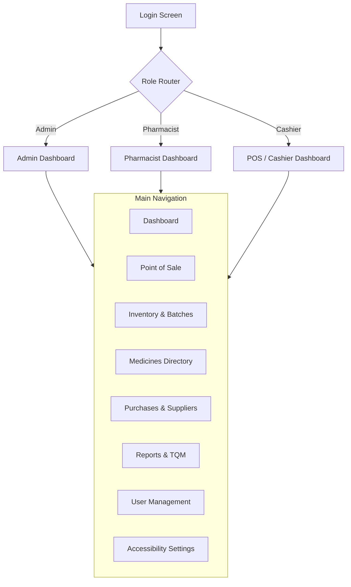

# Pharmacy Management System: UI/UX & Screen Flow Design

## 1. Application Navigation & Screen Hierarchy

The application will use a consistent Left Navigation Sidebar for routing, and a Main Content Area for screen rendering.



---

## 2. Permission Matrix (UI Visibility)

| Module / Screen | Admin | Pharmacist | Cashier (Staff) |
| :--- | :--- | :--- | :--- |
| **Dashboard** | Full Metrics | Operational Metrics | Shift Metrics |
| **Point of Sale (POS)** | View / Use | View / Use | View / Use |
| **Inventory / Batches** | Full CRUD | Full CRUD | Read-Only |
| **Medicines Directory** | Full CRUD | Full CRUD | Read-Only |
| **Purchases & Suppliers** | Full CRUD | Full CRUD | Hidden |
| **Customers** | Full CRUD | Full CRUD | Full CRUD |
| **Reports & Audit Logs** | View All | View Operational | Hidden |
| **User Management** | Full CRUD | Hidden | Hidden |
| **Accessibility Settings**| Full Access | Full Access | Full Access |

*(Note: The UI will hide buttons/screens based on the user's JWT role. The FastAPI backend will enforce these rules if bypassed.)*

---

## 3. UI States (Handling API Communication)

Because the UI communicates with the FastAPI backend over HTTP, every screen must gracefully handle the following states:
* **Loading State:** Disable buttons and show an indeterminate progress bar (`CTkProgressBar`) while awaiting HTTP responses.
* **Empty State:** If a table (e.g., inventory) returns 0 rows, show a clear, centered message: *"No records found."*
* **Success State:** Briefly display a transient success message (e.g., a `CTkLabel` in green or a non-blocking toast notification).
* **Validation Error State:** If the UI detects an empty field before sending, or if Pydantic returns a 422, highlight the specific input field in red and show a localized error string.
* **API Error State (TQM Blocking):** For business rules (e.g., selling expired batch), display a clear, modal `CTkMessagebox` requiring user acknowledgement.
* **Confirmation State:** Destructive actions (e.g., deleting a user) require a confirmation dialog.

---

## 4. Accessibility Rules (Q12 TQM Goal)

This system is built around the **Q12 Accessibility** standard:
1. **High Contrast & Dark Mode:** Handled via CustomTkinter's `set_appearance_mode()`. We will provide a strict "High Contrast Dark" and "High Contrast Light" `.json` theme file.
2. **Font Resizing:** The UI will use a central `AccessibilityManager` singleton. All font sizes will be defined as `(font_name, base_size * scale_factor)`. A slider in settings updates `scale_factor` and redraws the UI.
3. **Keyboard Navigation:** Every actionable widget will be explicitly added to a focus traversal loop (`widget.focus_set()`). The active widget will have a distinct, bright outline (Visible Focus Indicator).
4. **Minimalist Layout:** Eliminate unnecessary borders and decorative elements. Maximize padding to make click targets larger.
5. **Accessible Form Labels:** Every `CTkEntry` must have an associated, explicitly worded `CTkLabel` placed directly above it. No relying purely on placeholder text.

---

## 5. Screen Layouts & Wireframes

### A. Login Screen
```text
+---------------------------------------------------------+
|                                                         |
|         [ Pharmacy Management System ]                  |
|                                                         |
|         Username: [_______________________]             |
|                                                         |
|         Password: [_______________________]             |
|                                                         |
|         [       LOGIN (Enter)         ]                 |
|                                                         |
|         [⚙ Accessibility Settings]                      |
+---------------------------------------------------------+
```

### B. Point of Sale (POS) - Cashier
```text
+----------------+----------------------------------------+
| [Sidebar]      | [ POS Terminal ]                       |
| Dashboard      |                                        |
| > POS          | Search Medicine / Barcode:             |
| Inventory      | [_______________] [🔍 Search]          |
| Customers      |                                        |
| Settings       | CART:                                  |
|                | +------------------------------------+ |
|                | | Item       | Batch | Qty | Price   | |
| [Logged in:]   | | Paracetamol| B-123 | [2] | $10.00  | |
| [Jane Cash]    | +------------------------------------+ |
|                |                                        |
|                | Customer (Opt): [______________]       |
|                |                      Total: $10.00     |
|                |                      [ CHECKOUT ]      |
+----------------+----------------------------------------+
```

### C. Inventory & Batches (Pharmacist)
```text
+----------------+----------------------------------------+
| [Sidebar]      | [ Inventory Management ]               |
| > Inventory    |                                        |
|                | Filter: [All] [Near Expiry] [Low Stock]|
|                | +------------------------------------+ |
|                | | Medicine   | Batch | Qty | Expiry  | |
|                | | Paracetamol| B-123 | 500 | 2028-12 | |
|                | | Amoxicillin| B-001 | 10  | 2026-10 |*| *(Highlighted Red)*
|                | +------------------------------------+ |
|                |                                        |
|                | [ + Record New Purchase / Batch ]      |
+----------------+----------------------------------------+
```

### D. Accessibility Settings (Global)
```text
+----------------+----------------------------------------+
| [Sidebar]      | [ Accessibility Settings ]             |
| > Settings     |                                        |
|                | Theme Mode:                            |
|                | ( ) Light   ( ) Dark   (*) High Contrast
|                |                                        |
|                | UI Scale (Text Size):                  |
|                | [ 100% ] -----O---------- [ 200% ]     |
|                |                                        |
|                | Navigation:                            |
|                | [x] Enable Bold Focus Rings            |
|                |                                        |
|                |                 [ Save & Apply ]       |
+----------------+----------------------------------------+
```

---

## 6. Click-by-Click UI Workflows

### Workflow 1: Add Medicine (Pharmacist)
1. User clicks **"Medicines Directory"** in sidebar.
2. UI requests `GET /medicines` and populates the data table.
3. User clicks **"Add New Medicine"**. UI opens a modal form.
4. User enters Name, Generic Name, Reorder Level. Focus moves via `Tab`.
5. User presses `Enter` or clicks **"Save"**.
6. UI shows indeterminate loading bar and disables the Save button.
7. API Client sends `POST /medicines`.
8. *Success:* Modal closes, table reloads, green toast "Medicine Added".

### Workflow 2: Process a Sale (Cashier)
1. User clicks **"POS"** in sidebar.
2. Focus defaults to "Search Medicine" input.
3. User types "Para", presses enter. UI calls `GET /batches/search?q=Para`.
4. API returns available, non-expired batches. UI renders a dropdown/list.
5. User selects batch, sets Quantity to 2, clicks **"Add to Cart"**.
6. User clicks **"Checkout"**. UI disables checkout button.
7. API Client sends `POST /sales`.
8. *Success:* UI clears cart, shows a modal with receipt details and "Sale Successful". Focus returns to Search input.

### Workflow 3: Block Expired Sale (TQM Process Control)
1. User bypasses search (e.g., via barcode scanner) and inputs a batch ID that is expired.
2. User clicks **"Checkout"**.
3. API Client sends `POST /sales`.
4. FastAPI Service layer intercepts the business rule violation. Returns `422 Unprocessable Entity` with `{"error": "Batch B-001 is expired and cannot be sold."}`
5. UI catches `422`. Hides loading bar.
6. UI displays a high-contrast modal: ⚠️ **"TQM ERROR: Batch B-001 is expired and cannot be sold."**
7. User must explicitly click "Acknowledge" to dismiss. Cart is not processed.

### Workflow 4: Handle Insufficient Stock
1. User attempts to checkout 500 units of a batch that only has 10 left.
2. API attempts transaction, hits PostgreSQL `CHECK (current_quantity >= 0)`.
3. Database rolls back. API returns `409 Conflict`.
4. UI displays modal: ⚠️ **"INSUFFICIENT STOCK: Only 10 units available for this batch."**

### Workflow 5: Change Accessibility Settings
1. User clicks **"⚙ Settings"** on the login screen or sidebar.
2. User drags the "UI Scale" slider to 150%.
3. UI immediately calls `AccessibilityManager.apply_scale(1.5)`.
4. CustomTkinter redraws all fonts across the application dynamically.
5. User clicks "Save". UI writes preferences to a local `config.json` so the setting persists upon app restart.

---

## 7. Testing Checklist

* [ ] **Navigation Check:** Can the user reach every permitted screen without using a mouse (Tab/Enter only)?
* [ ] **Role Hiding Check:** Does a Cashier logging in see the "User Management" sidebar item? (It should be hidden).
* [ ] **Form Validation Check:** Do empty required fields trigger red UI outlines and localized text before API calls?
* [ ] **API Blocking Check:** Does the UI correctly parse and display `4xx` errors from the FastAPI backend when TQM rules are violated?
* [ ] **Accessibility Scale Check:** Do UI elements overlap or break when the font scale is set to 200%?
* [ ] **Focus Indicator Check:** Is it visually obvious which text box or button currently has keyboard focus?

---

## 8. Summary & Next Steps

**Architectural Alignment:** The UI is completely isolated from PostgreSQL. It acts as an HTTP client to the FastAPI layer. Complex business rules (calculating totals, checking expiry) are strictly delegated to the backend, ensuring the client remains a lightweight, secure presentation layer.

**Unresolved Decisions:**
* Do we want to print physical receipts via a connected thermal printer, or just display them on-screen for the initial project phase? (Assuming on-screen for now).

**Next Implementation Step:**
The design documentation is fully complete (`srs.md`, `architecture.md`, `database-design.md`, `ui-design.md`). 
The next step is to **Initialize the Application Codebase**: Setup the Python virtual environment, create the folder structure defined in the architecture, configure `requirements.txt`, and initialize the FastAPI and SQLAlchemy base configurations.
